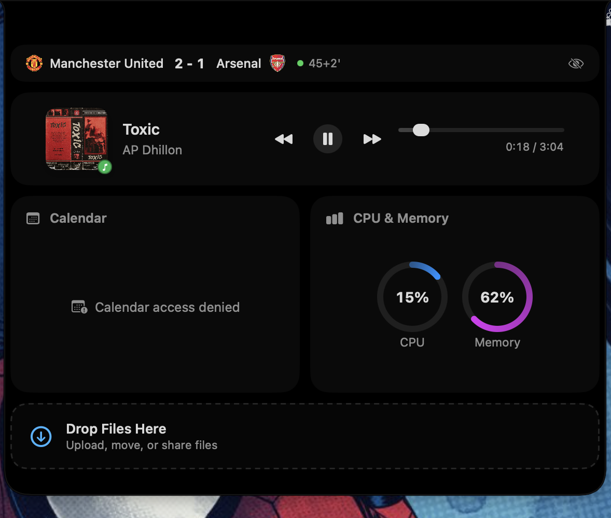

# The Notch App

A macOS menu bar app that turns the notch into a hover-activated dashboard, and
makes it merge with whatever's happening on your Mac instead of just sitting
there as a black cutout — the same "live activity" trick the iPhone does with
its Dynamic Island.

When nothing's going on, it's just the notch:


Play something in Spotify or Apple Music and it widens into a compact pill —
artwork on one side, a live waveform on the other — without you ever hovering:


Pick a favorite Premier League team and, whenever they're actually playing,
the notch shows the live score instead — crest, score, match clock (added
time included), and a pulsing live dot:


Hover over the notch for the full dashboard: playback controls, today's
calendar, CPU/memory, and a drop zone for quick file shelving:



## Features

- **Now playing** — Spotify and Apple Music, with play/pause, skip, seek, and
  album art, shown both in the compact pill and the expanded panel.
- **Live Premier League scores** — pick a favorite team from the menu bar;
  while they're playing, the notch shows the score automatically. Dismiss it
  for the rest of that match from the menu bar or the expanded panel's hide
  button whenever you want.
- **Today's calendar** — a month view plus today's events.
- **System stats** — live CPU and memory usage.
- **File shelf** — drag files onto the expanded panel to park them for later.
- Works on Macs with a physical notch *and* Macs without one (it fakes a
  software notch in the menu bar so the same interaction model still works).

## Install

### Homebrew (recommended)

```sh
brew tap 11a55an/the-notch-app https://github.com/11a55an/the-notch-app
brew install --cask the-notch-app
```

### Manual

Download the latest `.zip` from
[Releases](https://github.com/11a55an/the-notch-app/releases), unzip it, and
move `The Notch App.app` to `/Applications`.

### Gatekeeper

This app isn't notarized by Apple — it's a solo project, not worth a $99/yr
developer account yet — so on first launch (via Homebrew or manually) macOS
will likely say it's from an "unidentified developer." Either click through
via *System Settings → Privacy & Security → Open Anyway*, or run:

```sh
xattr -dr com.apple.quarantine "/Applications/The Notch App.app"
```

### Build from source

```sh
brew install xcodegen
xcodegen generate
open TheNotchApp.xcodeproj
```

Build and run from Xcode (⌘R). The app has no Dock icon or main window — look
for the notch panel and the menu bar status item.

## Permissions

The app will ask for:

- **Calendar access**, to show today's events.
- **Automation (Apple Events)**, to control Spotify and Apple Music playback
  and to read now-playing state from Chrome tabs.

Live scores come from ESPN's public scoreboard endpoint — no account or API
key needed.

## Requirements

- macOS 14 (Sonoma) or later
- Xcode 16+ and [XcodeGen](https://github.com/yonaskolb/XcodeGen) (only for
  building from source)

## Notes for contributors

Now-playing data comes from AppleScript (Apple Events) against Spotify and
Music.app, not the private MediaRemote framework, so the app can eventually
be sandboxed for Mac App Store distribution. This means only Spotify and
Apple Music are supported for native playback control, not arbitrary apps
(Chrome tabs are read/controlled via injected JavaScript instead).
